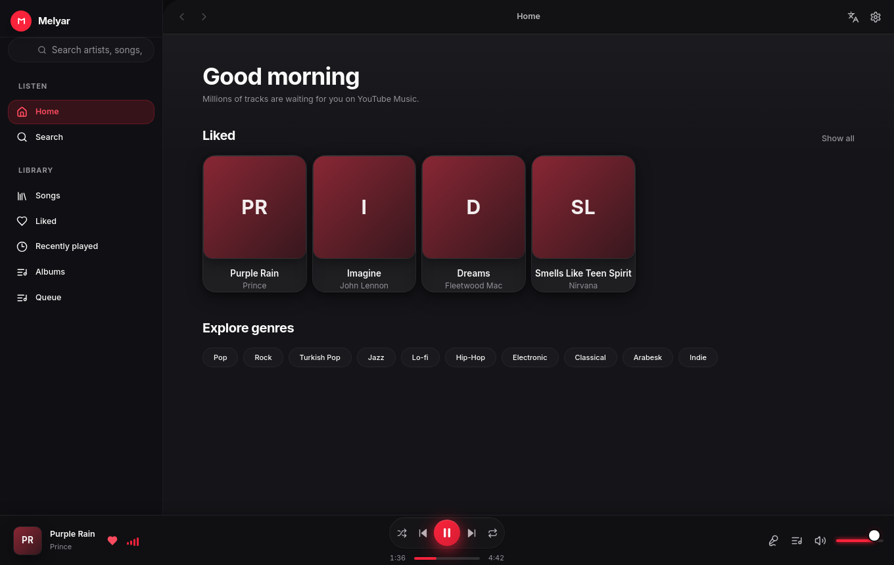
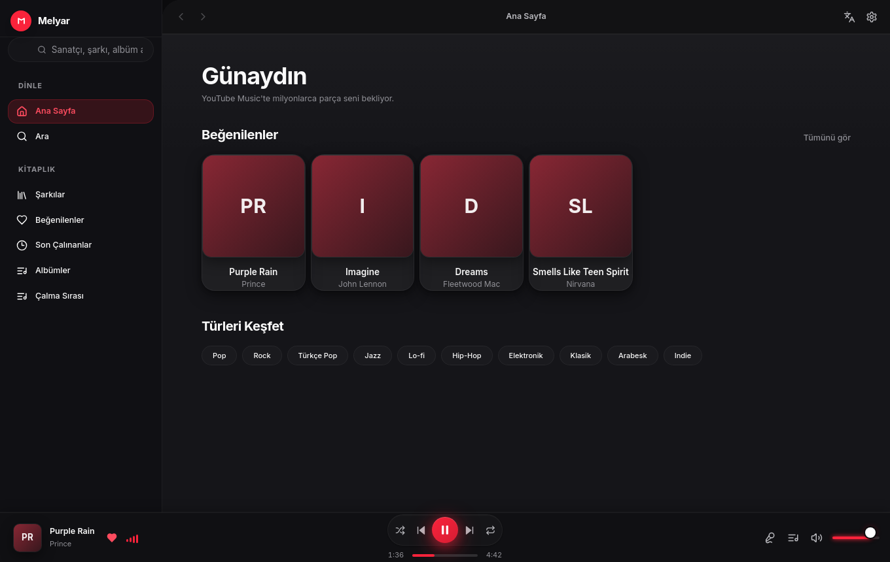

<div align="center">

# Melyar

**Ultra-lightweight native desktop client for YouTube Music**

[](https://github.com/MAKHMUDuz/melyar/actions/workflows/ci.yml)
[](https://github.com/MAKHMUDuz/melyar/releases/latest)
[](LICENSE-APACHE)
[](https://github.com/MAKHMUDuz/melyar/discussions)

</div>

Melyar is a Linux-first, local-first desktop music client for YouTube Music. It combines a fast Rust core, a native Qt/C++ shell, and a polished React + TypeScript interface to deliver a clean, responsive listening experience without the overhead of heavier desktop frameworks.



## Why Melyar

Melyar is built for people who want a music player that feels native on Linux:

- Small runtime footprint
- Fast startup and responsive controls
- Deep desktop integration with MPRIS and Waybar
- No account requirement to launch the app
- Local-first behavior with personal library data stored on disk

## Highlights

- Search, browse, and play YouTube Music content
- Playback with `libmpv` and gapless streaming behavior
- Queue management, shuffle, repeat, volume, and seek controls
- Synced LRC lyrics with plain-text fallback
- Favorites, history, albums, artists, and library views
- Liquid Glass-inspired interface with light/dark theming
- Native Linux media integration via MPRIS and Unix socket IPC

## Screenshots

Melyar is available in multiple languages and can be switched at runtime from the sidebar or settings panel.



## Architecture

Melyar separates the app into three layers:

```text
React + TypeScript UI
        │
        │ QWebChannel
        ▼
Qt / C++ bridge
        │
        ▼
Rust core ── playback, library, provider logic, IPC
        │
        ▼
mpv audio playback
```

The C++ ↔ Rust boundary is connected via the `cxx` bridge, while the UI communicates with the core through Qt/WebChannel.

## Quick start

### Requirements

- Rust ≥ 1.75
- CMake ≥ 3.25
- Qt 6 (`Core`, `Gui`, `Quick`, `Qml`, `WebEngineQuick`, `WebChannel`)
- Node.js ≥ 20
- pnpm ≥ 9
- mpv ≥ 2.x with development files
- `pkg-config`
- `yt-dlp` (optional, used when installed)

### Build and run

```bash
git clone https://github.com/MAKHMUDuz/melyar.git
cd melyar

cd ui_web
pnpm install
pnpm build
cd ..

cmake -S . -B build -DCMAKE_BUILD_TYPE=Release
cmake --build build -j"$(nproc)"
./build/melyar
```

## Desktop integration

### MPRIS

Melyar registers itself on the session bus as `org.mpris.MediaPlayer2.melyar`, so Linux desktops can discover playback state without any manual configuration.

### Waybar / status bar

Melyar also exposes a zero-latency Unix socket at `$XDG_RUNTIME_DIR/melyar.sock` for tools such as Waybar, Polybar, and i3status.

## Local data

| Data | Location |
|---|---|
| Database | `~/.local/share/melyar/melyar.db` |
| IPC socket | `$XDG_RUNTIME_DIR/melyar.sock` |

## Roadmap

Melyar is actively under development. The project aims to improve Linux desktop integration, library workflows, provider breadth, and reliability over time.

See [ROADMAP.md](ROADMAP.md) for the detailed project plan and upcoming work.

## Contributing

Contributions, bug reports, and focused pull requests are welcome.

- [CONTRIBUTING.md](CONTRIBUTING.md)
- [docs/ARCHITECTURE.md](docs/ARCHITECTURE.md)
- [ROADMAP.md](ROADMAP.md)

## License

Melyar is dual-licensed under:

- MIT — [LICENSE-MIT](LICENSE-MIT)
- Apache 2.0 — [LICENSE-APACHE](LICENSE-APACHE)

`SPDX-License-Identifier: MIT OR Apache-2.0`

---

<div align="center">
<sub>Built with Rust, Qt 6, React, and a lot of care for the details.</sub>
</div>
